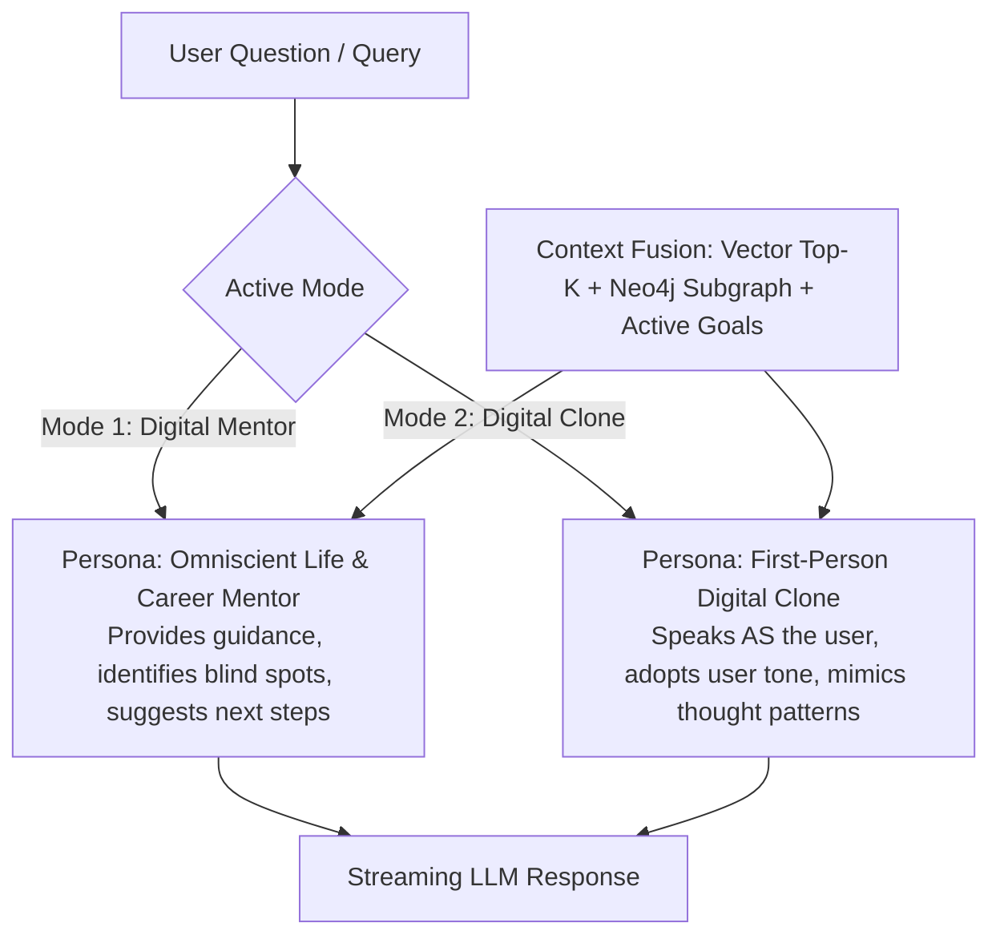

# Document 01: Feature Specification & System Modules

This document provides the exhaustive functional requirements, user stories, input/output data flows, and acceptance criteria for all 9 core subsystems of **OmniLife Digital Twin**.

---

## Module 1: Authentication, Multi-Tenant Isolation & User Profile

### 1.1 Overview
Provides secure user registration, JWT-based session management, and comprehensive personal profile modeling covering education, professional background, current focus areas, and communication preferences.

### 1.2 User Stories
- **US-1.1**: As a user, I can register and login securely using email/password so that my personal memories and graph data remain strictly private and isolated.
- **US-1.2**: As a user, I can configure my Digital Twin profile (Current Title, Target Roles, Bio, Philosophy, Communication Tone: *Analytical*, *Concise*, *Warm*, or *Academic*).
- **US-1.3**: As a system, every single query to PostgreSQL, ChromaDB, and Neo4j MUST enforce the authenticated `user_id` as a partition key.

### 1.3 Key Features & Acceptance Criteria
- **Password Security**: Passwords hashed with `bcrypt` (work factor 12).
- **Session Tokens**: JWT with 7-day expiration and automated refresh handling.
- **Profile Fields**:
  - `full_name`, `email`, `avatar_url`, `headline`, `bio`
  - `target_roles` (array of strings, e.g. `["AI Research Scientist", "Staff ML Engineer"]`)
  - `personality_traits` (JSON object: `openness`, `analytical_depth`, `brevity_preference`, `formality`)
  - `communication_style` (Prompt instructions on how the clone should talk)

---

## Module 2: Multi-Source Knowledge Ingestion & Memory Vault

### 2.1 Overview
The Memory Vault is the ingestion engine that transforms raw unstructured files (resumes, project notes, PDFs, markdown journals, plain text) into chunked, embedded vector memories and structured graph nodes.

### 2.2 Ingestion Pipeline Flow
```mermaid
flowchart LR
    File[Uploaded File / Raw Text] --> Parser[Document Parser\n(PyPDF / Markdown / TXT)]
    Parser --> CleanText[Normalized Clean Text]
    CleanText --> Chunking[Semantic Recursive Chunking\n(500 chars, 50 overlap)]
    Chunking --> Embedding[Local Vector Embeddings\n(all-MiniLM-L6-v2 ONNX / Ollama)]
    Embedding --> Chroma[(ChromaDB Collection)]
    
    CleanText --> LLMExtract[Local LLM Entity Extractor\n(Ollama llama3.2 / JSON Mode)]
    LLMExtract --> Triples[Entities & Relationships]
    Triples --> Neo4j[(Neo4j Knowledge Graph)]
```

### 2.3 User Stories
- **US-2.1**: As a user, I can drag and drop my resume (`.pdf`, `.docx`, `.txt`) and personal project markdown notes.
- **US-2.2**: As a user, I can view my "Memory Vault" table showing all indexed chunks, source documents, tags, and timestamps.
- **US-2.3**: As a user, I can manually edit or delete any memory chunk or document, and the system automatically deletes or updates the associated ChromaDB vectors and graph artifacts.

---

## Module 3: Knowledge Graph Engine (Neo4j GraphRAG)

### 3.1 Overview
While vector databases capture semantic similarity, they cannot answer relational questions like: *"What projects did I use PyTorch in that directly contributed to my Career Goal of becoming an ML Engineer?"* The Knowledge Graph engine extracts and queries an explicit typed schema.

### 3.2 Graph Schema Ontology
- **Nodes**:
  - `(:User {id, name, email})`
  - `(:Skill {id, name, category, proficiency})` (e.g., Python, Docker, Transformers, System Design)
  - `(:Project {id, title, description, url, started_at, completed_at})`
  - `(:Goal {id, title, category, target_date, status})`
  - `(:Institution {id, name, type})` (e.g., MAIT, Google, OpenAI)
  - `(:Topic {id, name, field})` (e.g., Deep Learning, Distributed Systems)
  - `(:Person {id, name, relationship})` (Mentors, collaborators, managers)

- **Relationships**:
  - `(User)-[:HAS_SKILL {level: 'advanced', years: 2}]->(Skill)`
  - `(Skill)-[:USED_IN]->(Project)`
  - `(Project)-[:ADVANCES]->(Goal)`
  - `(Goal)-[:REQUIRES_SKILL {urgency: 'high'}]->(Skill)`
  - `(User)-[:STUDIED_AT]->(Institution)`
  - `(Project)-[:COLLABORATED_WITH]->(Person)`
  - `(Skill)-[:SUBTOPIC_OF]->(Topic)`

### 3.3 Acceptance Criteria
- Auto-deduplication of entities (e.g., "fastapi" and "FastAPI" map to the same normalized `Skill` node).
- Real-time graph updates when a user logs a new project or updates a goal.
- Subgraph retrieval endpoint that returns nodes and links filtered by `user_id` formatted specifically for force-directed graph UI rendering.

---

## Module 4: Dual-Mode AI Digital Twin Conversational Engine

### 4.1 Overview
OmniLife provides a chat interface with an instant toggle between two distinct cognitive operating modes:



### 4.2 Mode Specifications
1. **The Digital Mentor (Advisor Mode)**:
   - Perspective: Second-person ("Based on your recent work on the distributed cache project, you should focus on...").
   - Behavior: Constructive critique, holds user accountable to their goals, surfaces forgotten knowledge, cross-references skills with industry roadmaps.
2. **The Digital Clone (Simulated Self Mode)**:
   - Perspective: First-person ("In my experience building the OmniLife graph engine, I prioritized Neo4j because...").
   - Behavior: Simulates the user's personality, communication quirks, and exact background knowledge. Useful for interview preparation, elevator pitch testing, or delegating queries.

### 4.3 Streaming Interface
- All responses stream via Server-Sent Events (SSE) for low latency.
- Citations/Sources are included as metadata pills (e.g., `[Source: Resume.pdf, p. 1]`, `[Graph: Project 'OmniLife' -> Skill 'FastAPI']`).

---

## Module 5: Goal, Milestone & Habit Kanban System

### 5.1 Overview
Enables users to define high-level life and career goals, which the AI automatically decomposes into hierarchical milestones and weekly actionable tasks.

### 5.2 Key Features
- **Hierarchical Structure**: `Life Objective` (e.g., "Land Staff AI Engineer Role") -> `Milestone` (e.g., "Build and open-source a multi-agent system") -> `Tasks` (e.g., "Implement ChromaDB vector store", "Write unit tests for graph retriever").
- **AI Task Decomposition**: A one-click button on any goal triggers the LLM to analyze the user's current knowledge graph and generate a step-by-step roadmap tailored to their exact skill gaps.
- **Kanban Board**: Drag-and-drop tasks across `TODO`, `IN_PROGRESS`, `BLOCKED`, and `DONE`.
- **Bidirectional Graph Sync**: Completing a task tagged with a skill automatically increments that skill's experience metric in Neo4j.

---

## Module 6: Career Path Prediction & Skill Gap Simulator

### 6.1 Overview
Compares the user's live knowledge graph against benchmark roles (e.g., Full Stack AI Engineer, ML Systems Engineer, Solutions Architect) to generate a quantitative readiness score and a prioritized learning curriculum.

### 6.2 Key Features
- **Role Benchmarks**: Pre-loaded standard skill ontologies for 10+ modern tech roles.
- **Readiness Score Algorithm**:
  $$\text{Match Percentage} = \frac{\sum \text{Matched Required Skills}}{\sum \text{Total Required Skills for Role}} \times 100$$
- **Graph Diff Visualization**: Highlights mastered skills in green, in-progress skills in yellow, and critical missing skills in red.
- **Curated Next-Action Recommendations**: Suggests targeted open-source projects, seminal research papers, or hands-on builds to bridge the highest-leverage gap.

---

## Module 7: Behavioral Analytics & Productivity Intelligence

### 7.1 Overview
Provides longitudinal insights into the user's work habits, velocity, and focus areas, detecting stagnation or burnout before it occurs.

### 7.2 Key Features
- **Daily Reflection & Focus Logger**: Quick 2-minute daily check-in (what worked, what was difficult, energy level 1-5).
- **Productivity Dashboard**: Visualizes weekly task velocity, focus distribution across skill domains, and active streaks.
- **Automated Sunday AI Debrief**: Generates a personalized weekly retrospective highlighting breakthroughs, completed milestones, and recommended adjustments for the upcoming week.

---

## Module 8: Interactive Voice Interaction Suite

### 8.1 Overview
Allows hands-free conversational dialogue with the Digital Twin, providing natural speech-to-text input and realistic audio output.

### 8.2 Key Features
- **Speech-to-Text (STT)**: Direct browser Web Speech API integration with zero latency, with optional backend Whisper API transcription for high-fidelity audio files.
- **Text-to-Speech (TTS)**: Integration with Python `edge-tts` (natural neural voices) or browser `speechSynthesis` for immediate audio response streaming.
- **Animated Audio Visualizer**: Dynamic sound wave pulse in the UI while listening and speaking.

---

## Module 9: Privacy, Data Sovereignty & Memory Controls

### 9.1 Overview
Ensures complete user control over their data, memory traces, and AI persona.

### 9.2 Key Features
- **Granular Memory Deletion**: One-click purge of specific documents, chats, or graph nodes.
- **Zero Cross-Contamination**: Hard tenant isolation verified via test suites on every query.
- **Data Export**: Full JSON export of user profile, chat history, memory chunks, and graph topology.
