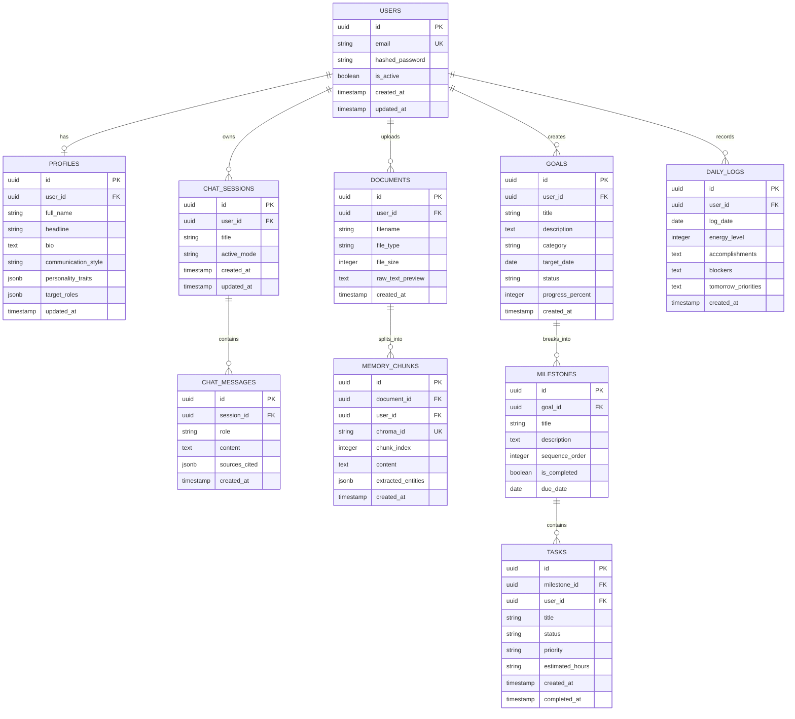

# Document 02: Data Models & Graph Schemas

This document provides the definitive data schemas across **PostgreSQL**, **Neo4j**, and **ChromaDB**, ensuring consistent typing across the backend and frontend.

---

## 1. PostgreSQL Relational Schema (SQLAlchemy 2.0 Async)



### Python SQLAlchemy Declarative Models (`app/models/`)

```python
# app/models/base.py
import uuid
from datetime import datetime
from sqlalchemy import DateTime, func
from sqlalchemy.dialects.postgresql import UUID
from sqlalchemy.orm import DeclarativeBase, Mapped, mapped_column

class Base(DeclarativeBase):
    pass

class TimestampMixin:
    created_at: Mapped[datetime] = mapped_column(DateTime(timezone=True), server_default=func.now())
    updated_at: Mapped[datetime] = mapped_column(DateTime(timezone=True), server_default=func.now(), onupdate=func.now())

# app/models/user.py
from typing import List, Optional
from sqlalchemy import String, Boolean, ForeignKey, Integer, Text, JSON
from sqlalchemy.orm import relationship

class User(Base, TimestampMixin):
    __tablename__ = "users"

    id: Mapped[uuid.UUID] = mapped_column(UUID(as_uuid=True), primary_key=True, default=uuid.uuid4)
    email: Mapped[str] = mapped_column(String(255), unique=True, index=True, nullable=False)
    hashed_password: Mapped[str] = mapped_column(String(255), nullable=False)
    is_active: Mapped[bool] = mapped_column(Boolean, default=True)

    profile: Mapped[Optional["Profile"]] = relationship("Profile", back_populates="user", uselist=False, cascade="all, delete-orphan")
    documents: Mapped[List["Document"]] = relationship("Document", back_populates="user", cascade="all, delete-orphan")
    goals: Mapped[List["Goal"]] = relationship("Goal", back_populates="user", cascade="all, delete-orphan")
    chat_sessions: Mapped[List["ChatSession"]] = relationship("ChatSession", back_populates="user", cascade="all, delete-orphan")
    daily_logs: Mapped[List["DailyLog"]] = relationship("DailyLog", back_populates="user", cascade="all, delete-orphan")

class Profile(Base, TimestampMixin):
    __tablename__ = "profiles"

    id: Mapped[uuid.UUID] = mapped_column(UUID(as_uuid=True), primary_key=True, default=uuid.uuid4)
    user_id: Mapped[uuid.UUID] = mapped_column(UUID(as_uuid=True), ForeignKey("users.id", ondelete="CASCADE"), unique=True)
    full_name: Mapped[str] = mapped_column(String(100), nullable=False)
    headline: Mapped[Optional[str]] = mapped_column(String(255), nullable=True)
    bio: Mapped[Optional[str]] = mapped_column(Text, nullable=True)
    communication_style: Mapped[str] = mapped_column(String(50), default="Analytical & Direct")
    personality_traits: Mapped[dict] = mapped_column(JSON, default=dict) # {"openness": 0.8, "detail_focus": 0.9}
    target_roles: Mapped[list] = mapped_column(JSON, default=list) # ["AI Engineer", "Tech Lead"]

    user: Mapped["User"] = relationship("User", back_populates="profile")
```

---

## 2. Neo4j Knowledge Graph Schema & Cypher Constraints

### 2.1 Unique Constraints and Indexes
Run these during database initialization:
```cypher
// Ensure unique entity identifiers scoped to user or system
CREATE CONSTRAINT user_id_unique IF NOT EXISTS FOR (u:User) REQUIRE u.id IS UNIQUE;
CREATE CONSTRAINT skill_name_unique IF NOT EXISTS FOR (s:Skill) REQUIRE s.normalized_name IS UNIQUE;
CREATE CONSTRAINT project_id_unique IF NOT EXISTS FOR (p:Project) REQUIRE p.id IS UNIQUE;
CREATE CONSTRAINT goal_id_unique IF NOT EXISTS FOR (g:Goal) REQUIRE g.id IS UNIQUE;
CREATE CONSTRAINT person_id_unique IF NOT EXISTS FOR (p:Person) REQUIRE p.id IS UNIQUE;
CREATE CONSTRAINT topic_name_unique IF NOT EXISTS FOR (t:Topic) REQUIRE t.normalized_name IS UNIQUE;

// Performance indexes for fast neighborhood expansion
CREATE INDEX skill_category_idx IF NOT EXISTS FOR (s:Skill) ON (s.category);
CREATE INDEX project_user_idx IF NOT EXISTS FOR (p:Project) ON (p.user_id);
CREATE INDEX goal_user_idx IF NOT EXISTS FOR (g:Goal) ON (g.user_id);
```

### 2.2 Node Labels and Property Specifications
1. **`User`**
   - `id`: UUID (matches Postgres user id)
   - `name`: String
   - `email`: String
2. **`Skill`**
   - `id`: String (e.g., `skill_python`)
   - `name`: String (e.g., `Python`)
   - `normalized_name`: String (lowercase trimmed, e.g., `python`)
   - `category`: String (`"Language"`, `"Framework"`, `"ML/AI"`, `"DevOps"`, `"Soft Skill"`)
3. **`Project`**
   - `id`: UUID
   - `user_id`: UUID
   - `title`: String
   - `description`: String
   - `status`: String (`"Active"`, `"Completed"`)
4. **`Goal`**
   - `id`: UUID
   - `user_id`: UUID
   - `title`: String
   - `target_date`: Date / String
5. **`Topic`**
   - `name`: String (e.g., `"Distributed Systems"`, `"Deep Learning"`)
   - `domain`: String (`"Computer Science"`)
6. **`Person`**
   - `id`: UUID
   - `user_id`: UUID
   - `name`: String
   - `role`: String (e.g., `"Mentor"`, `"Co-author"`, `"Manager"`)

### 2.3 Relationship Types & Edge Properties
- `(:User)-[:HAS_SKILL {proficiency: "Expert" | "Intermediate" | "Beginner", years_exp: Float}]->(:Skill)`
- `(:Project)-[:UTILIZES {significance: "Core" | "Secondary"}]->(:Skill)`
- `(:Project)-[:ADVANCES]->(:Goal)`
- `(:Goal)-[:REQUIRES_SKILL {priority: "High" | "Medium"}]->(:Skill)`
- `(:User)-[:OWNS_PROJECT]->(:Project)`
- `(:User)-[:PURSUES_GOAL]->(:Goal)`
- `(:Project)-[:COLLABORATED_WITH {contribution: String}]->(:Person)`
- `(:Skill)-[:SUBTOPIC_OF]->(:Topic)`

---

## 3. ChromaDB Vector Store Specification

### 3.1 Collection Architecture
OmniLife maintains a dedicated ChromaDB collection: `omnilife_memory_vault`, powered by the local `all-MiniLM-L6-v2` ONNX embedding engine (zero external API calls).

### 3.2 Document Storage Payload
When text from resumes, markdown notes, or conversations is chunked and stored in ChromaDB:

```json
{
  "id": "chunk_7a82f3-1",
  "document": "Built a real-time event streaming pipeline using Apache Kafka, FastAPI, and PostgreSQL handling 15k req/sec.",
  "metadata": {
    "user_id": "9b1deb4d-3b7d-4bad-9bdd-2b0d7b3dcb6d",
    "document_id": "4e1a49a2-9441-4eb2-a634-1cb340fa18a5",
    "filename": "Resume_Taniksh_2026.pdf",
    "chunk_index": 1,
    "source_type": "RESUME",
    "tags": "streaming,kafka,fastapi,postgresql",
    "created_at": "2026-10-24T14:40:00Z"
  }
}
```

### 3.3 Semantic Search Filter
Every vector similarity query strictly incorporates a metadata filter to guarantee multi-tenant security:
```python
results = collection.query(
    query_texts=["What experience do I have with high-throughput backend systems?"],
    n_results=5,
    where={"user_id": current_user_id}
)
```

---

## 4. Benchmark Role Graph Seeds (For Skill Gap Engine)

The system includes pre-defined benchmark standard roles in Neo4j to compute readiness:

```cypher
// Example Benchmark Target Role: "AI Systems Engineer"
MERGE (r:BenchmarkRole {id: "role_ai_systems_engineer", title: "AI Systems Engineer"})
MERGE (s1:Skill {normalized_name: "python", name: "Python", category: "Language"})
MERGE (s2:Skill {normalized_name: "pytorch", name: "PyTorch", category: "ML/AI"})
MERGE (s3:Skill {normalized_name: "docker", name: "Docker", category: "DevOps"})
MERGE (s4:Skill {normalized_name: "fastapi", name: "FastAPI", category: "Framework"})
MERGE (s5:Skill {normalized_name: "distributed systems", name: "Distributed Systems", category: "Topic"})
MERGE (s6:Skill {normalized_name: "triton inference server", name: "Triton", category: "ML/AI"})

MERGE (r)-[:BENCHMARK_REQUIRES {importance: "Mandatory"}]->(s1)
MERGE (r)-[:BENCHMARK_REQUIRES {importance: "Mandatory"}]->(s2)
MERGE (r)-[:BENCHMARK_REQUIRES {importance: "Mandatory"}]->(s3)
MERGE (r)-[:BENCHMARK_REQUIRES {importance: "Mandatory"}]->(s4)
MERGE (r)-[:BENCHMARK_REQUIRES {importance: "Recommended"}]->(s5)
MERGE (r)-[:BENCHMARK_REQUIRES {importance: "Recommended"}]->(s6);
```
