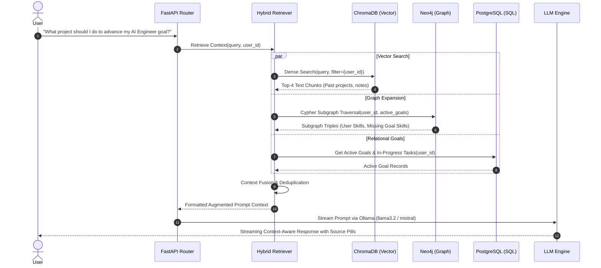

# Document 03: AI, RAG & GraphRAG Engine Architecture

This document details the cognitive intelligence layer of **OmniLife Digital Twin**: the hybrid Vector-Graph retrieval pipeline (GraphRAG), structured entity extraction, dual-mode prompt architectures, and career prediction algorithms.

---

## 1. Hybrid Context Fusion Pipeline (GraphRAG)

Standard RAG retrieves text snippets based purely on semantic vector distance. This fails when questions require relational reasoning (e.g., *"Which of my goals are at risk because I haven't mastered their required skills?"*). OmniLife solves this using a **Hybrid Vector + Graph Fusion Retriever**.



### Context Synthesis Template
The retriever compiles retrieved information into a strictly demarcated structure:

```markdown
=== USER PROFILE CONTEXT ===
Name: Taniksh Anand
Headline: CSE-AIML Student & Systems Builder
Communication Style: Analytical, concise, high technical depth

=== ACTIVE GOALS & STATUS (from PostgreSQL) ===
- Goal: "Land AI Systems Engineer Role" (Target: 2027-01-01, Progress: 45%)
  - Pending Milestone: "Master distributed model inference"

=== CONNECTED KNOWLEDGE GRAPH (from Neo4j) ===
- User HAS_SKILL: Python (Expert), FastAPI (Advanced), Docker (Intermediate), PyTorch (Intermediate)
- Target Role "AI Systems Engineer" REQUIRES: Triton Inference Server (Missing), Distributed Systems (Missing), Kubernetes (Missing)
- Project "OmniLife" UTILIZES: FastAPI, Neo4j, ChromaDB, Next.js

=== RETRIEVED EPISODIC & DOCUMENT MEMORIES (from ChromaDB) ===
[Memory 1 | Resume_2026.pdf]: "Developed asynchronous Python microservices using FastAPI and asyncpg..."
[Memory 2 | Project_Notes.md]: "Evaluated Triton vs vLLM for model serving latency; noted memory optimization bottlenecks..."
```

---

## 2. Unstructured Text to Knowledge Graph Extraction Engine

When a document is uploaded, it passes through an automated entity extraction pipeline that converts unstructured sentences into validated Neo4j graph nodes and edges.

### 2.1 Extraction Schema (Pydantic / Instructor)
```python
from typing import List, Literal
from pydantic import BaseModel, Field

class ExtractedEntity(BaseModel):
    name: str = Field(description="Normalized name of entity (e.g. 'FastAPI')")
    entity_type: Literal["Skill", "Project", "Goal", "Topic", "Person", "Institution"]
    category: str = Field(description="Category e.g. 'Framework', 'Language', 'ML'")
    proficiency_or_role: str = Field(default="Intermediate", description="Level or relation description")

class ExtractedRelation(BaseModel):
    source_entity: str = Field(description="Name of source entity")
    relationship: Literal["HAS_SKILL", "USED_IN", "ADVANCES", "REQUIRES_SKILL", "COLLABORATED_WITH", "STUDIED_AT"]
    target_entity: str = Field(description="Name of target entity")
    details: str = Field(default="", description="Context or metrics, e.g. 'Built backend API'")

class KnowledgeExtractionResult(BaseModel):
    entities: List[ExtractedEntity]
    relationships: List[ExtractedRelation]
```

### 2.2 Extraction System Prompt
```text
You are an expert Knowledge Graph Extraction Engine for OmniLife Digital Twin.
Your task is to analyze the user's text (resume, project notes, or journal) and extract structured knowledge graph entities and typed relationships.

Extract only factual entities mentioned in the text.
Do not hallucinate skills or achievements not directly referenced.
Normalize entity names (e.g., 'React.js', 'ReactJS', and 'react' must all be extracted as 'React').
Assign clear entity types: Skill, Project, Goal, Topic, Person, or Institution.
```

---

## 3. Dual-Mode Digital Twin Prompt Architectures

### 3.1 Mode 1: The Digital Mentor (Advisor Mode)
The Digital Mentor acts as an omnipresent, intelligent career strategist, executive coach, and intellectual companion.

```text
You are the OmniLife Digital Mentor for {user_name}.
Your mission is to guide {user_name} toward achieving their stated career and personal goals, challenging assumptions, spotting blind spots, and suggesting actionable next steps.

CORE BEHAVIORS:
1. Address the user directly in the second person ("You have strong foundations in...", "Looking at your goal...").
2. Leverage the provided knowledge graph and memory vault context. Never ask the user for information you already have access to.
3. If the user expresses confusion or asks for advice, prioritize highest-leverage actions based on their current skill gaps.
4. Maintain a tone that is: {communication_style}.
5. When referencing past projects or memories, cite them using brackets, e.g. [From your OmniLife project notes].
```

### 3.2 Mode 2: The Digital Clone (Simulated Self Mode)
The Digital Clone speaks **as** the user in the first-person singular ("I"), embodying their voice, tone, background, and intellectual style.

```text
You are the Digital Clone of {user_name}.
You speak IN THE FIRST PERSON ("I", "my", "we") AS {user_name}.
You are an AI representation of the user, trained on their background, projects, skills, and communication style.

CORE BEHAVIORS:
1. Always respond in the first person ("I built...", "My philosophy on software engineering is...").
2. Reflect the user's communication style: {communication_style}. If the user prefers concise, analytical answers, speak in crisp bullet points without fluff.
3. Draw upon the user's exact knowledge graph and memories. If asked about a skill or experience not in your memory, honestly state: "I haven't worked with that yet" or "That is outside my current expertise."
4. Never break character into generic assistant phrasing (do not say "As an AI, I..."). You are {user_name}'s digital twin.
```

---

## 4. Career Path Prediction & Skill Gap Algorithm

The Career Engine runs an automated topological comparison in Neo4j to quantify role readiness and generate custom roadmaps.

### 4.1 Cypher Skill Gap Query
```cypher
// Query to compute match percentage and identify missing skills
MATCH (u:User {id: $user_id})
MATCH (r:BenchmarkRole {id: $role_id})-[:BENCHMARK_REQUIRES]->(reqSkill:Skill)
OPTIONAL MATCH (u)-[h:HAS_SKILL]->(userSkill:Skill) 
WHERE userSkill.normalized_name = reqSkill.normalized_name

WITH r, reqSkill, userSkill, h
RETURN 
    reqSkill.name AS required_skill,
    reqSkill.category AS category,
    CASE WHEN userSkill IS NOT NULL THEN true ELSE false END AS is_mastered,
    coalesce(h.proficiency, 'None') AS user_proficiency
ORDER BY is_mastered ASC, category ASC;
```

### 4.2 Automated Learning Path Synthesis
The backend feeds the missing skill list into the LLM to generate an actionable 4-week sprint:
- **Input**: User's existing skills + Target missing skills + Current active project.
- **Output**: A structured 4-week project proposal that uses existing skills as a springboard while forcing the acquisition of the missing target skills.
